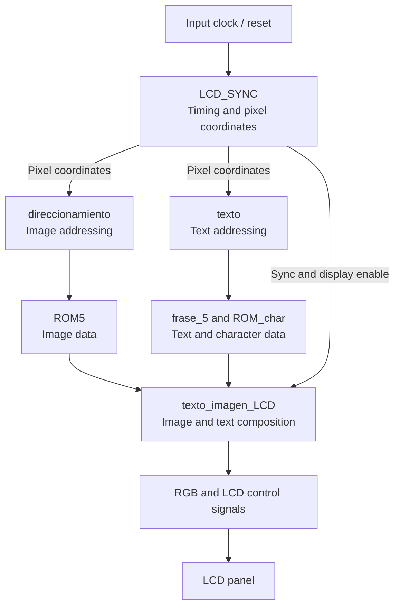

# Verilog LCD Graphics Controller

A modular **RGB LCD graphics controller** implemented in **Verilog HDL** for the **Terasic DE2-115 FPGA development board**. The design generates display timing and pixel coordinates, reads image and character data from FPGA ROMs, and supports rendering text over an image.

The design was developed and tested using **Intel/Altera Quartus**, with functional simulations performed in **ModelSim** and display output evaluated on the DE2-115 hardware.

## Features

- **LCD synchronization:** horizontal and vertical timing, display enable, pixel clock, display reset, and row/column coordinates.
- **ROM-based image display:** addresses image memory using the current pixel position and drives RGB outputs.
- **Character rendering:** retrieves character bitmap data from ROM and maps it to on-screen pixels.
- **Text generation:** reads character codes from memory and places text on the display.
- **Image and text composition:** overlays text on top of a stored image.
- **Functional verification:** includes testbenches for image output, text output, and combined image/text output.

## Hardware and tools

| Item | Details |
| --- | --- |
| FPGA development board | **Terasic DE2-115** |
| Display interface | RGB LCD with synchronization and control signals |
| Hardware description language | **Verilog HDL** |
| FPGA design tools | **Intel/Altera Quartus** |
| Simulation | **ModelSim** |
| Memory implementation | Intel/Altera ROM IP and initialization files |

## Repository structure

```text
Verilog-LCD-Graphics-Controller/
├── rtl/
│   ├── count_param.v
│   ├── LCD_SYNC.v
│   ├── direccionamiento.v
│   ├── imagen_lcd.v
│   ├── texto.v
│   ├── texto_LCD.v
│   ├── texto_imagen_LCD.v
│   └── ip/
│       ├── PLL.v
│       ├── frase_5.v
│       ├── ROM_char.v
│       └── ROM5.v
├── tb/
│   ├── tb_imagen_lcd.v
│   ├── tb_texto_LCD.v
│   └── tb_texto_imagen_LCD.v
├── char_rom.hex
├── SDP_2_t5_hex.hex
├── text_rom_ejemplo.mif
└── README.md
```

## RTL modules

| Module | Description |
| --- | --- |
| `count_param.v` | Parameterized counter used by the display timing logic. |
| `LCD_SYNC.v` | Generates LCD synchronization, control signals, and pixel row/column positions. |
| `direccionamiento.v` | Translates display coordinates into ROM addresses for image pixels. |
| `imagen_lcd.v` | Displays RGB image data retrieved from ROM. |
| `texto.v` | Generates addresses and pixel information for text rendering. |
| `texto_LCD.v` | Produces LCD output for text display. |
| `texto_imagen_LCD.v` | Combines image pixels and rendered text in one LCD output. |
| `ip/PLL.v` | Quartus-generated PLL module for display clock generation. |
| `ip/frase_5.v` | Quartus-generated ROM for stored text content. |
| `ip/ROM_char.v` | Quartus-generated character bitmap ROM. |
| `ip/ROM5.v` | Quartus-generated ROM for image data. |

## Architecture

The **`LCD_SYNC`** module provides timing and display coordinates. Image and text modules use these coordinates to access their respective ROM data. The final **`texto_imagen_LCD`** module combines both sources to drive the RGB LCD outputs.



*The diagram summarizes the functional data flow; see the Verilog modules for actual signal connections and hierarchy.*

## ROM initialization files

| File | Used by | Purpose |
| --- | --- | --- |
| `char_rom.hex` | `ip/ROM_char.v` | Character bitmap data. |
| `SDP_2_t5_hex.hex` | `ip/ROM5.v` | Image pixel data. |
| `text_rom_ejemplo.mif` | `ip/frase_5.v` | Text/character sequence data. |

These files are kept at the repository root to match the initialization filenames referenced by the original generated ROM modules. If creating a Quartus project in a different working directory, adjust the memory-file paths accordingly.

## Simulation and verification

The repository includes the following Verilog testbenches:

| Testbench | Purpose |
| --- | --- |
| `tb/tb_imagen_lcd.v` | Verifies ROM-based image display behavior. |
| `tb/tb_texto_LCD.v` | Verifies character and text rendering behavior. |
| `tb/tb_texto_imagen_LCD.v` | Verifies combined image and text rendering. |

The original development workflow used **ModelSim** for functional simulation, including inspection of timing signals and pixel output. Some testbenches generate text-based pixel data for external display inspection.

**Note:** The generated PLL and ROM modules depend on Intel/Altera simulation primitives (such as `altsyncram`). Simulating the complete design may require the corresponding Quartus/ModelSim libraries and compatible IP settings.

## Reusing the design

1. Create a Quartus project targeting the **Terasic DE2-115** FPGA board.
2. Add the relevant Verilog modules from `rtl/` and `rtl/ip/`.
3. Make the `.hex` and `.mif` initialization files accessible to the Quartus project.
4. Configure or regenerate the PLL and ROM IP as required by your Quartus version.
5. Set up the appropriate LCD pin assignments, clock constraints, and top-level module.
6. For functional verification, configure ModelSim with the required Intel/Altera libraries and run the applicable testbench.

## Scope

This repository contains **Verilog source code, selected generated IP modules, testbenches, and required ROM initialization data**. It does **not** include the complete original Quartus project, pin assignments, timing constraints, generated compilation databases, or programming bitstreams.

As a result, it is a **source-level implementation and verification reference**, rather than a ready-to-program Quartus project. The required board-specific setup must be recreated before compiling or deploying it on hardware.

